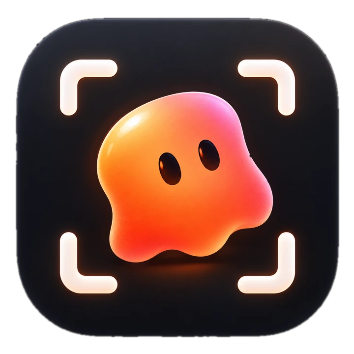
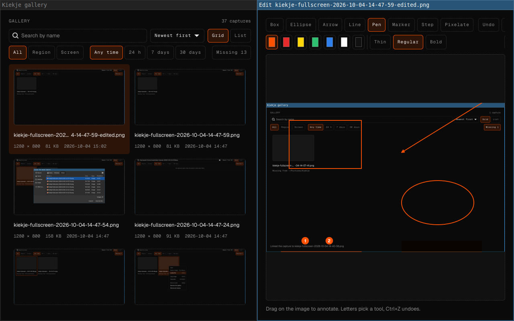

<p align="center">
  
</p>

<h1 align="center">Kiekje</h1>

**Kiekje** *(noun)*
/ˈkik.jə/, *Dutch slang, "a quick snapshot or photo."*

A screenshot tray app for Linux. Kiekje grabs the screen the moment you trigger it, shows that frozen frame so you can pick the part you want, then copies it, saves it and keeps it in a gallery. It targets KDE Plasma and Hyprland (Omarchy) on Wayland.

<p align="center">
  
  
  
  
  
</p>

<p align="center">
  
</p>
<p align="center">
  <sub>Recorded in a headless Sway session with a lab build.</sub>
</p>

> [!WARNING]
> Kiekje is pre-release (`0.1.0-alpha.5`). Everything below has been tested in virtual machines and headless sessions only. Runs on real hardware with Omarchy, Plasma and GNOME are still open and tracked in [issue #41](https://github.com/remcostoeten/kiekje/issues/41). Detailed lab results are in [docs/phase-0-results.md](docs/phase-0-results.md).

## Supported

Status legend: **Lab tested** means it passed in a VM or headless session. **Unverified** means the code path exists but has not run on that desktop yet.

### Desktops

| Desktop | Capture backend | Overlay | Global shortcuts | Status |
| --- | --- | --- | --- | --- |
| KDE Plasma 6, Wayland | KWin `ScreenShot2` over D-Bus | layer-shell | GlobalShortcuts portal, kglobalaccel | Lab tested on Plasma 6.7.5 in a VM |
| Hyprland, Omarchy | `ext-image-copy-capture`, then `wlr-screencopy` | layer-shell | managed `hyprland.conf` include, GlobalShortcuts portal | Lab tested on Hyprland 0.56.2 in a VM. Omarchy unverified |
| Sway and other wlroots compositors | `ext-image-copy-capture`, then `wlr-screencopy` | layer-shell | GlobalShortcuts portal where the portal offers it | Lab tested on headless sway 1.9 and 1.12 |
| GNOME, Wayland | xdg-desktop-portal Screenshot | fullscreen window | GlobalShortcuts portal | Lab tested on GNOME 50.5 in a VM. Shortcut keys and overlay focus unverified |
| KDE Plasma, X11 | KWin `ScreenShot2` | fullscreen window | kglobalaccel | Unverified |

The backend is picked at runtime from the Wayland registry, D-Bus names and portal versions, never from which binaries are installed. Run `kiekje doctor` to see what your session supports.

### Distributions

The release binary links gtk4-layer-shell statically. CI installs and starts it on every distribution below before a release ships.

| Distribution | x86_64 | aarch64 | Styling |
| --- | --- | --- | --- |
| Arch Linux | yes | not built | full |
| Fedora | yes | yes | full |
| openSUSE Tumbleweed | yes | not built | full |
| Debian 13 | yes | yes | full |
| Ubuntu 25.10 | yes | not built | full |
| Ubuntu 24.04 | yes | yes | full |

Linux Mint 22 shares Ubuntu 24.04's GTK 4.14 and behaves the same, but is not in CI. Started in CI means the binary launches and opens its surfaces. It does not mean a desktop was clicked through on that distribution.

### Packages

| Format | Architectures | Status |
| --- | --- | --- |
| Tarball with `install.sh` | x86_64 | In release `0.1.0-alpha.2` |
| Tarball | aarch64 | From 0.1.0-alpha.3 |
| `.deb` | x86_64, aarch64 | From 0.1.0-alpha.3 |
| `.rpm` | x86_64, aarch64 | From 0.1.0-alpha.3 |
| AUR `kiekje`, `kiekje-bin` | x86_64 | PKGBUILDs in `packaging/`, not published to the AUR yet |
| From source with Cargo | any | Works |

## Not supported

| What | Status | Notes |
| --- | --- | --- |
| X11 capture backend | On hold | Pure X11 sessions other than Plasma have no capture path. `doctor` reports it as unavailable. |
| Flatpak | Not yet | Native packages come first. A portal-only Flatpak build is planned later. |
| macOS, Windows | Not planned | Kiekje is Linux only. |
| Screen recording | Post-V1 | Planned with GStreamer. |
| Text recognition (OCR) | Post-V1 | Planned with Tesseract. |
| Update check | Not built | There is no release feed to check against yet. |
| Window capture as its own mode | Partial | On Plasma 6 and Hyprland a click selects the window under the pointer inside the region overlay. There is no separate window command. |
| Real hardware | Unverified | No run on physical machines with Omarchy, Plasma or GNOME yet. See [issue #41](https://github.com/remcostoeten/kiekje/issues/41). |

## Features

### Capture

| Feature | Details | Status |
| --- | --- | --- |
| Frozen-frame selection | The screen is grabbed at trigger time; you select on that still image | Lab tested |
| Region capture | Drag to select, release to copy and save | Lab tested |
| Full screen | Every monitor, stitched into one image | Lab tested |
| Repeat last region | Crops the last selected area again without the overlay | Lab tested on sway |
| Delay | `--delay` up to 60 seconds | Lab tested on sway |
| Multi-monitor | Selections can cross monitors and mixed scales, cropped at native resolution | Lab tested on Plasma, sway, Hyprland |
| Fractional scaling and rotation | Mapped back to physical pixels | Lab tested on sway and Hyprland virtual outputs |
| Window snapping | The window under the pointer lights up; click to take it | Plasma 6 and Hyprland, unverified |
| Pixel loupe | Magnifier with position and hex colour under the pointer | Unverified on desktops |
| Colour picker | C copies the hex colour; picked colours are listed in the gallery | Unverified on desktops |
| Hint bar | Lists the overlay keys; `?` hides it | Lab tested on sway |

### Annotation

| Feature | Details | Status |
| --- | --- | --- |
| Inline editor | Draw on the selection right on the overlay, Spectacle style, with Accept, Cancel, Save, Save as and Copy | Lab tested on sway |
| Editor window | Opens from the gallery or straight after a capture | Lab tested on sway |
| Tools | Select, box, ellipse, arrow, line, pen, marker, numbered steps, text, pixelate, crop | Lab tested on sway |
| Styling | 7 colours, size slider (1 to 24 px), opacity slider (10 to 100%), remembered between editors | Lab tested on sway |
| Edit shapes | Move, resize, nudge, restyle and delete placed shapes | Lab tested on sway |
| Right-click menu | Every tool, line size, undo, redo and delete | Lab tested on sway |
| Rebindable keys | Every tool and thinner or thicker lines, set in Settings, Shortcuts, Drawing keys | Lab tested on sway |
| Undo and redo | Every change is one undoable step | Unit tested |
| Non-destructive | Saving an edit writes a new `-edited` file; the original stays | Lab tested on sway |

### Output and library

| Feature | Details | Status |
| --- | --- | --- |
| Clipboard | PNG on the clipboard, also from the background daemon on Plasma | Lab tested |
| Save to disk | PNG in `~/Pictures/Kiekje`, exclusive create, never overwrites | Lab tested |
| Unsaved captures | With saving off, captures go to `~/.cache/kiekje/unsaved`, show an Unsaved badge, and Keep moves one to the folder. Pruned after 7 days | Unit tested, unverified on desktops |
| Filename templates | e.g. `kiekje-{mode}-{date}-{time}`, live preview in Settings | Unit and lab tested |
| Pin on screen | Keep a capture floating above other windows; drag, scroll to zoom | Unverified on desktops |
| Notifications | With the image, Open and Show in folder actions | Lab tested |
| Capture sound | Sound theme shutter or the bundled one, needs the GStreamer base plugins | Lab tested |
| Gallery | Grid and list views, search, sorting, and filters for kind, period, dimensions, file size, annotated and unsaved | Filters unit tested, unverified on desktops |
| File actions | Open, show in folder, copy image, copy path, trash, remove, edit, pin | Lab tested on sway |
| Missing files | Detects moved or deleted files and lets you relink them | Lab tested on sway |
| Large libraries | Thumbnails load only for visible items; 10,000 captures tested | Lab tested on sway |

### App

| Feature | Details | Status |
| --- | --- | --- |
| Tray | Styled popover on left click, native menu on right click | Lab tested on Plasma. Waybar and GNOME unverified |
| Global shortcuts | Print for a region, Shift+Print for every screen, rebindable with a recorder | Lab tested on Plasma and Hyprland |
| Settings | Capture, Shortcuts, Saving, General and About pages | Lab tested on sway |
| Start at login | Toggle in Settings | Unverified |
| Doctor | Reports what the session supports and how to fix the rest | Lab tested |
| Danger zone | Reset settings, clear gallery, colours or thumbnails, with a two-click guard | Lab tested on sway |
| Single instance | CLI commands talk to the running daemon over D-Bus | Lab tested |

## Keys

### Overlay, before selecting

| Key | Action |
| --- | --- |
| Drag | Select a region |
| Click | Take the window under the pointer (Plasma 6, Hyprland) |
| F | Take the monitor under the pointer |
| W, Enter | Take the hovered window |
| Shift+R | Take the last region |
| D, or a tool key | Start drawing first, pick the region afterwards with S |
| Z | Show or hide the loupe |
| C | Copy the colour under the pointer |
| ? | Show or hide the hint bar |
| Esc | Cancel |

### Inline editor

| Key | Action |
| --- | --- |
| Enter | Accept: copy and save |
| Esc | Cancel |
| Ctrl+C | Copy only |
| Ctrl+S | Save only |
| Ctrl+Shift+S | Save as |
| Arrows | Move the region |
| Ctrl+Arrows | Resize the region |
| Ctrl+Z | Undo |
| Ctrl+Shift+Z, Ctrl+Y | Redo |
| Shift while drawing | Straight line at 45 degree steps (line, arrow, pen), square or circle (box, ellipse) |

### Drawing tools (defaults, rebindable)

| Key | Tool |
| --- | --- |
| V | Select |
| R | Box |
| E | Ellipse |
| A | Arrow |
| L | Line |
| P | Pen |
| M | Marker |
| N | Numbered step |
| T | Text |
| X | Pixelate |
| C | Crop (editor window) |
| [ and ] | Thinner and thicker lines |

## Commands

| Command | What it does |
| --- | --- |
| `kiekje daemon` | Start the background instance with the tray |
| `kiekje capture [region]` | Freeze the screen and select an area (default) |
| `kiekje capture fullscreen` | Capture every screen |
| `kiekje capture repeat` | Capture the last region again |
| `kiekje capture ... --delay <s>` | Wait before grabbing the frame |
| `kiekje capture ... --edit` | Annotate before copying and saving |
| `kiekje capture ... --no-save` | Copy only |
| `kiekje menu` | Open or close the capture menu |
| `kiekje gallery` | Open the gallery |
| `kiekje settings` | Open settings |
| `kiekje pin <path>` | Keep an image on screen above other windows |
| `kiekje doctor` | Report what this session supports |
| `kiekje install-desktop-file` | Register the launcher entry, required on KDE |
| `kiekje quit` | Stop the running instance |
| `kiekje help`, `kiekje version` | Help and version |

## Install

### Arch Linux (AUR)

```bash
yay -S kiekje-bin
```

`kiekje-bin` installs the release binary. `yay -S kiekje` builds the same version from source.

### One line

```bash
curl -fsSL https://raw.githubusercontent.com/remcostoeten/kiekje/master/get.sh | bash
```

It picks the `.deb`, `.rpm` or tarball for your system from the newest release, checks it against `SHA256SUMS` and installs it with sudo. `KIEKJE_VERSION=v0.1.0-alpha.5` pins a release, `KIEKJE_FORMAT=tarball` skips the native package.

### Release packages

Download from [Releases](https://github.com/remcostoeten/kiekje/releases). `.deb` and `.rpm` packages ship from 0.1.0-alpha.3 on.

```bash
sudo apt install ./kiekje_VERSION-1_amd64.deb                              # Ubuntu, Debian, Mint
sudo dnf install ./kiekje-VERSION-1.x86_64.rpm                             # Fedora
sudo zypper install --allow-unsigned-rpm ./kiekje-VERSION-1.x86_64.rpm     # openSUSE
```

The tarball works anywhere else:

```bash
tar -xzf kiekje-VERSION-x86_64-linux.tar.gz
cd kiekje-VERSION-x86_64-linux
sudo packaging/install.sh ./kiekje
```

### Flatpak

Download `kiekje.flatpak` from the [latest release](https://github.com/remcostoeten/kiekje/releases/latest), then run:

```bash
flatpak install --user ./kiekje.flatpak
```

Flatpak uses the desktop portals for capture and global shortcuts.

### Nix

```bash
nix profile install github:remcostoeten/kiekje
```

This needs the `nix-command` and `flakes` experimental features. Without them, add `--extra-experimental-features 'nix-command flakes'`.

### From source

```bash
sudo pacman -S --needed rust gtk4 gtk4-layer-shell
git clone https://github.com/remcostoeten/kiekje.git
cd kiekje
cargo install --path . --locked
kiekje install-desktop-file
```

Other distributions need GTK 4.14 or newer and gtk4-layer-shell 1.1. [.github/workflows/ci.yml](.github/workflows/ci.yml) shows how to build gtk4-layer-shell from source.

## Getting started

1. Run `kiekje daemon`, or turn on Start Kiekje at login in Settings.
2. On KDE, run `kiekje install-desktop-file` once. KWin only allows screenshots from an app with a desktop file.
3. On Hyprland, add the `source` line that `kiekje doctor` prints to your `hyprland.conf` so the Print binds load.
4. Press Print, drag, and let go. The region is on your clipboard and in `~/Pictures/Kiekje`.

Settings live in `~/.config/kiekje/config.toml`. Set `[capture] after_selection = "edit"` to always open the inline editor after selecting.

Set `[saving] enabled = false`, or switch off Save captures to the folder in Settings, to only copy captures. Each one still lands in the gallery as Unsaved, kept in `~/.cache/kiekje/unsaved` for `keep_unsaved_days` (7 by default) and deleted at the first start after that. Keep in the gallery moves it to the capture folder. The editor's Save and Save as always write to the folder.

## Privacy

**Kiekje's code makes no network requests.** There are no analytics and no update check, and [Cargo.toml](Cargo.toml) lists no HTTP client.

| Data | Location |
| --- | --- |
| Captures | `~/Pictures/Kiekje` (configurable) |
| Settings | `$XDG_CONFIG_HOME/kiekje` |
| Gallery index | `$XDG_DATA_HOME/kiekje` |
| Thumbnails, unsaved captures | `$XDG_CACHE_HOME/kiekje` |

The guarantee stops at your desktop: a copied image sits on the clipboard where other apps can read it, and notifications, the screenshot portal and the tray go through your desktop's own services.

## Development

Needs Rust 1.85 or newer (edition 2024), GTK 4.14 and gtk4-layer-shell 1.1.

```bash
cargo build                                                                     # debug build
cargo run -- doctor                                                             # what this session supports
cargo test                                                                      # unit tests
cargo fmt --all && cargo clippy --all-targets --all-features -- -D warnings     # what CI checks
```

Architecture, capability matrix and phases are in [docs/proposal.md](docs/proposal.md). Layout, rules and code style are in [AGENTS.md](AGENTS.md). See [CONTRIBUTING.md](CONTRIBUTING.md) for pull requests and [SECURITY.md](SECURITY.md) to report a vulnerability.

<br/>

xxx,<br/>
[Remco Stoeten](https://remcostoeten.com)<br/>
<small>MIT</small><br/>
<small>PS The bundled Geist fonts are under the SIL Open Font License, see [resources/fonts/OFL.txt](resources/fonts/OFL.txt).</small>
